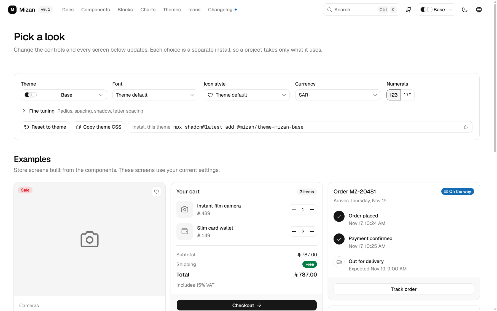
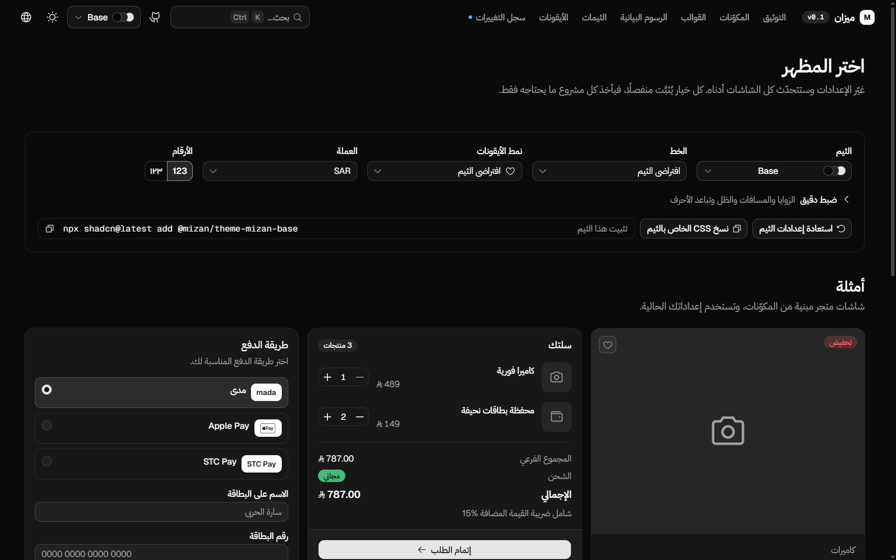
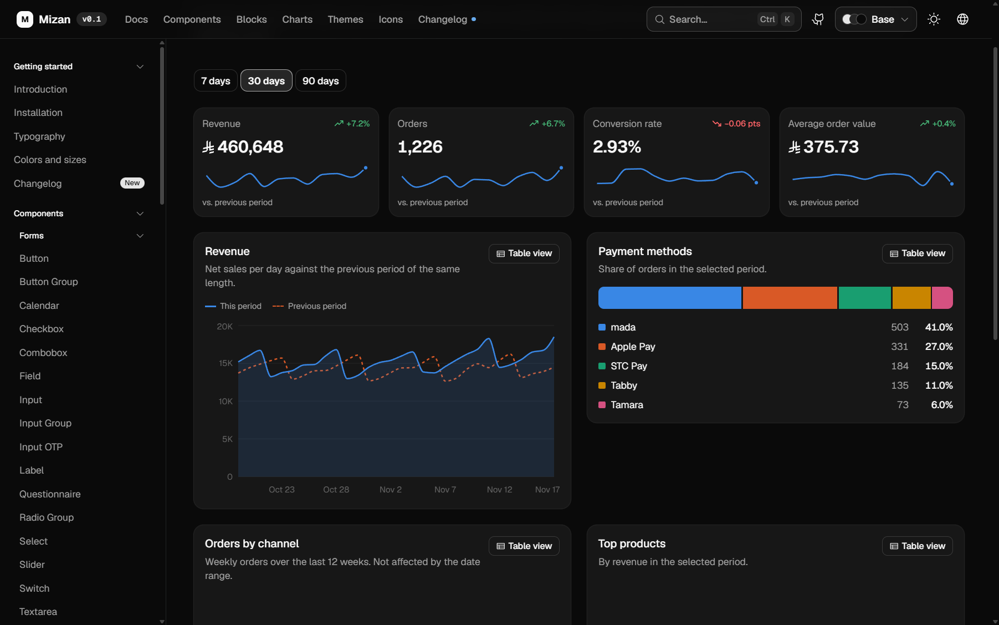
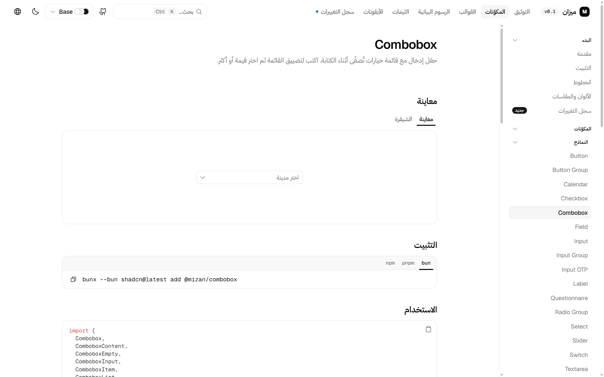
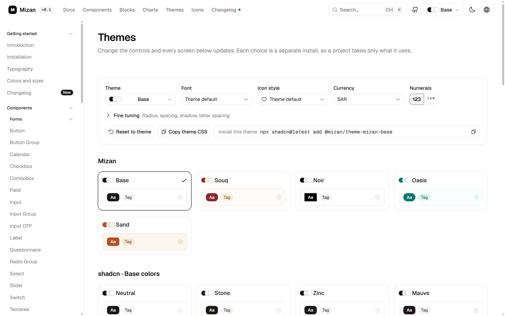

<div align="center">



# Mizan UI · ميزان

**Arabic and English UI components for shadcn. RTL-first, accessible, themeable.**

You install each item with the shadcn CLI and own the code.

[](https://github.com/MOHKSADAH/mizan-ui/actions/workflows/ci.yml)
[](LICENSE)
[](https://ui.shadcn.com/docs/registry)
[](https://base-ui.com)
[](https://tailwindcss.com)
[](https://nextjs.org)
[](https://bun.sh)
[](https://www.w3.org/TR/WCAG22/)

</div>

---

## Why Mizan

| | |
|---|---|
| **RTL-first** | Every component is written with logical CSS (`ms-`, `pe-`, `start-`). A CI guard fails on physical direction classes. Arrow keys, carousels and charts follow the text direction. |
| **Arabic done right** | Explicit calendar and digits in every `Intl` call. Hijri (Umm al-Qura) dates, the six Arabic plural forms, Arabic-Indic digits, and numbers isolated from bidi reordering. |
| **Gulf commerce** | `Price` uses the official Saudi riyal, UAE dirham and Omani rial signs. Phone (+966), national ID, IBAN and VAT checks, plus ZATCA Phase 1 QR. Payment-method slots for mada, Apple Pay, STC Pay, Tabby and Tamara. |
| **71 themes** | 5 Mizan themes, 7 shadcn base colors, 17 shadcn accents and 42 tweakcn presets, all generated from one data file. A contrast test checks every theme in light and dark, and themes that fail AA show a "not AA-verified" flag. |
| **Accessible** | Base UI primitives, WAI-ARIA patterns, visible focus, 24px hit areas, reduced-motion support, and live regions for async status. |
| **You own the code** | Built on the shadcn CLI. Install one item, read it, change it. |

## Screenshots

<table>
  <tr>
    <td width="50%"></td>
    <td width="50%"></td>
  </tr>
  <tr>
    <td align="center"><sub>Arabic, dark mode: the whole site mirrors</sub></td>
    <td align="center"><sub>Charts: series tokens, table view on every chart</sub></td>
  </tr>
  <tr>
    <td width="50%"></td>
    <td width="50%"></td>
  </tr>
  <tr>
    <td align="center"><sub>A docs page for every component, in both languages</sub></td>
    <td align="center"><sub>Themes gallery with install commands</sub></td>
  </tr>
</table>

## Install

Add an item to any shadcn project (Next.js, Vite, TanStack Start, React Router, Laravel with Inertia):

```bash
npx shadcn@latest add MOHKSADAH/mizan-ui/button
npx shadcn@latest add MOHKSADAH/mizan-ui/price
npx shadcn@latest add MOHKSADAH/mizan-ui/theme-mizan-base
```

To pin a release, add a tag: `MOHKSADAH/mizan-ui/button#v0.1.0`. Each item brings its npm and registry dependencies with it.

## What is inside

| Area | Items |
|---|---|
| Components | 60+ components on Base UI: forms, overlays, navigation, feedback, layout, data display, charts and sidebar |
| Commerce | `price` with official currency signs. More commerce, Gulf and form packs are in review (see below). |
| Themes | 71 `registry:theme` items with light and dark tokens, `success`/`warning`/`info` status colors, and chart series |
| Formatting | `format.ts`: numbers, money, compact, percent, signed values, dates and plurals, with a fixed calendar, digits and time zone |
| Docs site | Customizer, component pages, blocks pages, charts, themes, typography, tokens, icons and changelog, in English and Arabic |

### In review

| Pack | Contents |
|---|---|
| Gulf | Saudi ID, phone, IBAN and VAT inputs; region and city select; Saudi address form; Hijri calendar and date picker; slot picker; opening hours; ZATCA invoice |
| Commerce | Quantity stepper, rating, swatches, filter chips, payment methods, installments, VAT summary, coupon, product gallery, delivery estimate, order stepper |
| Inputs | File upload, tags input, multi-select, number field, time picker, password strength, input mask, color picker, signature pad |
| Display | Stat card, QR code, countdown, lightbox, comparison slider, marquee, table of contents, cookie consent, mega menu, tree view, timeline |
| ASCII | FIGlet text, spinner, progress, box, chart and terminal |
| Blocks | Marketing (navbars, heroes, features, pricing, FAQ, footers) and app (shells, dashboard, data tables, settings, auth, OTP) |

## Develop

```bash
bun install
bun run dev                # docs site at http://localhost:3000
bun run build              # shadcn build, registry validate, next build
bun run lint
bun run typecheck
bun test                   # format, themes contrast, registry and guard tests
bun run check:physical     # fail on physical direction classes in registry/
bun run registry:generate  # regenerate themes and registry.json from source data
```

The registry is generated. `registry/manifest.ts` and `scripts/data/themes.json` are the sources; do not edit `registry.json` by hand. Rules for agents and contributors are in [`AGENTS.md`](AGENTS.md).

## Credits

- [shadcn/ui](https://ui.shadcn.com) (MIT) and [Base UI](https://base-ui.com) (MIT)
- [Phosphor Icons](https://phosphoricons.com) (MIT)
- Theme presets from [tweakcn](https://tweakcn.com) (Apache-2.0)
- Signature artwork based on Alex Brush (SIL Open Font License)

Full credits are in [`NOTICE`](NOTICE).

## License

[MIT](LICENSE)
